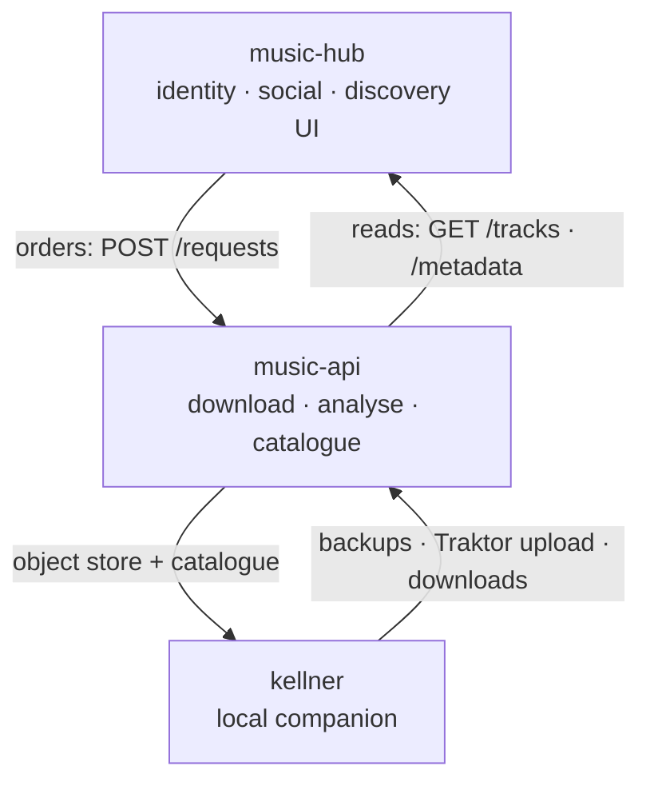

# Architecture — the music stack

> **Stack-level overview (2026-10-12).** This repository is a monorepo for a
> **music stack** of three projects, not a single app. The original single-user
> **Momo's Music Manager (MMM)** is sunset; its architecture is archived under
> [`docs/legacy/ARCHITECTURE.md`](legacy/ARCHITECTURE.md).

---

## The three projects

| Project                             | Path                          | Role                                              | Runs on          |
| ----------------------------------- | ----------------------------- | ------------------------------------------------- | ---------------- |
| **music-hub** (codename _spelunke_) | [`music-hub/`](../music-hub/) | Identity, social layer, discovery **UI**          | always-on server |
| **music-api**                       | [`music-api/`](../music-api/) | Download, analysis, catalogue — the **authority** | always-on server |
| **kellner**                         | [`kellner/`](../kellner/)     | Local **companion** per machine (skeleton)        | each Mac / PC    |

Per-project guidance is authoritative for its subtree:

- [`music-hub/AGENT.md`](../music-hub/AGENT.md)
- [`music-api/README.md`](../music-api/README.md)
- [`kellner/AGENT.md`](../kellner/AGENT.md)

---

## Authority split

The stack separates **who owns identity and social data** from **who owns audio
and metadata**. The rule of thumb:

> **The hub orders and reads; music-api downloads, analyses, remembers and
> expands.**

| Concern                                                                    | Owner         |
| -------------------------------------------------------------------------- | ------------- |
| Providers (Deezer / deemix / yt-dlp / spotDL), downloads, object store     | **music-api** |
| BPM/key/genre catalogue, audio analysis                                    | **music-api** |
| Identity & membership (Spotify / SoundCloud / YouTube ingest, user tokens) | **music-hub** |
| Social layer (tags, groups, collectives), discovery **UI**                 | **music-hub** |
| Local machine upkeep (backups, Traktor upload, downloads)                  | **kellner**   |

music-api is the **only** service that talks to the download providers and the
**only** writer of the metadata catalogue. The hub never downloads; it consumes
music-api metadata to power discovery and now-playing. kellner keeps the local
machines in sync with music-api.

---

## How they play together

- **Ordering** — the hub places orders with music-api (track / album / artist /
  url). music-api records them and schedules the work.
- **Reading** — the hub reads back tracks and metadata (batched) to build
  discovery views and to show BPM/key for whatever is playing.
- **Local sync** — kellner backs up the local library to music-api and uploads
  Traktor `collection.nml`.

The full design — authority split, the music-api engine, the hub's thin-client
role, and the now-playing → BPM path — is specified in the plan
[`plans/proposed/hub-crawl-everything.md`](../plans/proposed/hub-crawl-everything.md).

---

## Legacy

The original **Momo's Music Manager** (single-user, local files + Spotify,
Traktor) is **sunset**. Its code lives under `legacy/mmm/` and its docs under
[`docs/legacy/`](legacy/) ([`ARCHITECTURE.md`](legacy/ARCHITECTURE.md),
[`DECISIONS.md`](legacy/DECISIONS.md), [`mmm-README.md`](legacy/mmm-README.md)).
The legacy download service lives under `legacy/download-service/`.
