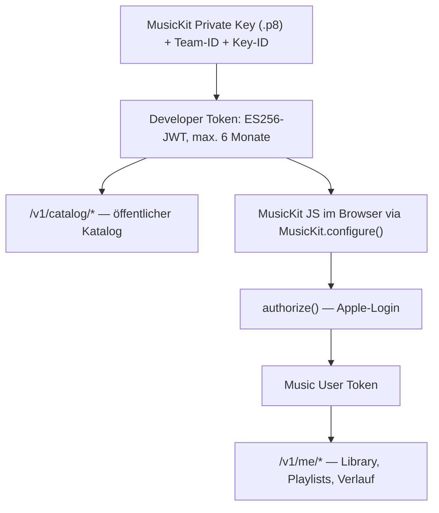
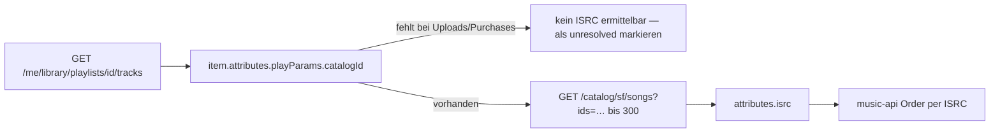

# Apple Music als Ingest-/Metadaten-Quelle — Faktenblatt

> **Stand:** 2026-11-16 · Recherche über Kagi/Web, Apple-Doku (Markdown-Versionen),
> Apple Developer Forums und Open-Source-Implementierungen.
> **Zielgruppe:** Entwickler:in, die Apple Music als Ingest-Quelle in `music-hub`
> anbindet (User-Playlists sichtbar machen, ISRCs an den bestehenden
> music-api-Order-Flow geben) — ohne selbst zu recherchieren.
> **Nicht bewertet:** Audio-Acquire von Apple (DRM). Das ist entschieden: es gibt
> keinen Weg, und wir gehen ihn nicht.

## 0. Quellen-Graduierung (Legende)

Jede Aussage trägt eine Quelle in eckigen Klammern. Vier Klassen:

| Klasse | Bedeutung                                                                                 | Gewicht                         |
| ------ | ----------------------------------------------------------------------------------------- | ------------------------------- |
| **A**  | Apple-Dokumentation (`developer.apple.com/documentation/...`), Vertragstext, Help-Artikel | primär                          |
| **B**  | Apple Developer Forums (inkl. Apple-Staff-Antworten)                                      | sekundär, Apple-nah             |
| **C**  | Reale Open-Source-Implementierungen (Code/Issues)                                         | empirisch, gut belegbar         |
| **D**  | Drittanbieter-Blogs/API-Verzeichnisse                                                     | nur Sekundärbeleg, oft unbelegt |

Alles, was **keine** dieser Klassen hat, ist im Text explizit als
**`unverifiziert`** markiert.

## 1. Auth-Modell

Apple Music kennt genau zwei Token-Arten. Beide sind **keine** OAuth-Tokens.



### 1.1 Developer Token

**Was er ist.** Ein signierter JWT, der _dich_ als Entwickler authentifiziert. Er
steht in **jedem** Apple-Music-API-Request im Header [A1]:

```
Authorization: Bearer <developer token>
```

**Claims — exakt so, wie Apple sie vorschreibt** [A1]:

| Teil    | Feld     | Wert                                                                                    |
| ------- | -------- | --------------------------------------------------------------------------------------- |
| Header  | `alg`    | `ES256` (nur dieser Algorithmus wird akzeptiert; alles andere → `401`)                  |
| Header  | `kid`    | 10-stellige **Key-ID** aus dem Developer Account                                        |
| Payload | `iss`    | 10-stellige **Team-ID** (Developer Account → Membership)                                |
| Payload | `iat`    | Ausstellungszeit, Unix-Sekunden, UTC                                                    |
| Payload | `exp`    | **max. `15777000`** Sekunden (6 Monate) **ab jetzt** — nicht ab `iat`                   |
| Payload | `origin` | _optional_, für Web-Clients empfohlen: Array von Origins, für die der Token gelten soll |

`origin` ist der einzige dokumentierte Domain-/Origin-Bindungsmechanismus:
„Only use this JWT if the origin header of the request matches one of the values in
the array“ [A1]. WWDC22 formuliert es als Empfehlung, nicht Pflicht: „For web
applications, we encourage providing an origin claim, which will issue a token
valid for your website only“ [A25].

**Schlüssel.** Signiert wird mit dem _MusicKit Private Key_ (`.p8`), den du als
Media-ID-Key im Developer Account anlegst [A1][A19]. ES256 = ECDSA über P-256 mit
SHA-256 [A1]. Open-Source-Implementierungen beschreiben das Format als
„ECDSA P-256, PKCS#8“ [C7] — das ist die konkrete Dateikodierung, nicht Teil der
Apple-Doku.

**Wann neu erzeugen.** Es gibt keinen Refresh-Endpoint und keinen Server-Roundtrip:
Der Token ist ein lokal signierter JWT. Neu erzeugen heißt: neu signieren
(Mikrosekunden), sobald `exp` naht [C7]. Praktisch: `exp` konservativ setzen (z. B.
24 h) und bei Bedarf neu signieren, oder 180 Tage und mit Puffer neu erzeugen. Die
Obergrenze ist hart: „must not be greater than 15777000 (6 months in seconds) from
the current Unix time on the server“ [A1].

> **Widerspruch, den du kennen musst:** Mehrere Entwickler berichten, dass ein
> formal gültiger ~6-Monats-Token nach Stunden bis Tagen `401` liefert
> ([reddit-Thread](https://www.reddit.com/r/AppleMusic/comments/1l3hjdl/musickit_developer_token_issue/),
> [pelauimagineering/apple-music-token-generator Issue #2](https://github.com/pelauimagineering/apple-music-token-generator/issues/2)).
> Eine offizielle Erklärung gibt es nicht. **Konsequenz für uns:** Token kurz
> halten, Neusignierung billig machen, `401` als „Token neu holen“ behandeln statt
> als fatalen Fehler. Ursache: **`unverifiziert`**.

**Wohin gehört er.** In den **Server**, nicht in den Browser — außer für MusicKit
JS. Apple selbst (WWDC17, Session 502): „keep your MusicKit private key secure.
Don't embed it in the binaries“ und Developer Tokens serverseitig erzeugen
([Transkript](https://asciiwwdc.com/2017/sessions/502)); die aktuelle Doku verlangt
einen signierten Token in _jedem_ Request [A1]. Für MusicKit JS muss der
Browser aber einen Developer Token bekommen (`MusicKit.configure({developerToken})`)
[A23]. Genau dafür ist der `origin`-Claim gedacht: ein separater, origin-beschränkter
Token fürs Frontend, ein unbeschränkter für den Server [A1][A25].

### 1.2 Music User Token (MUT)

**Wofür.** Alles unter `/v1/me/*` (Library, Playlists, Verlauf, Storefront) braucht
zusätzlich zum Developer Token einen MUT im Header [A2]:

```
Authorization: Bearer <developer token>
Music-User-Token: <music user token>
```

**Wie er entsteht.** Ausschließlich über MusicKit:

| Plattform              | Weg                                                                                                                                                                                                    |
| ---------------------- | ------------------------------------------------------------------------------------------------------------------------------------------------------------------------------------------------------ |
| iOS/tvOS/watchOS/macOS | MusicKit (Swift) — automatisch, inkl. automatischem Header-Decorating [A2]                                                                                                                             |
| **Web**                | **MusicKit JS** — `MusicKit.configure({ developerToken, app: { name, build } })`, dann `await music.authorize()`. Der `authorize()`-Flow öffnet Apple-Login/Consent und liefert den MUT [A2][A23][A24] |
| Android                | MusicKit for Android, manuell [A2]                                                                                                                                                                     |

`authorize()` ist idempotent gedacht: „If the user has previously authorized your
app, and their Music User Token (MUT) is still valid, then the `authorize` method
will resolve without opening the authorize flow“ [A24]. `unauthorize()` invalidiert
den MUT [A24].

> **Domain-Registrierung:** In MusicKit JS **v3** gibt es _keine_ dokumentierte
> Domain-Registrierung als Voraussetzung — `configure()` braucht nur den Developer
> Token [A23]. Die Domain-Bindung passiert, wenn überhaupt, über den
> `origin`-Claim des Developer Tokens [A1][A25]. Ob Apple zusätzlich intern pro
> Media-ID/Domain prüft, ist **`unverifiziert`**; in der v1-Ära war das anders, und
> alte Blogposts schleppen das noch mit.

**Gültigkeit.** Die offizielle Referenz sagt **nichts** zur Laufzeit [A2]. Eine
Apple-Staff-Antwort im Forum: „The expiration is 6 months currently“ [A28]. Das ist
die belastbarste Zahl, die es gibt — und sie ist Foren-Aussage, keine Doku. Ein
Entwickler berichtet im selben Thread dagegen 1–2 Tage [A28, zweite Antwort], ein
anderer bestätigt „not documented but I believe it is 6 months“ [C6]. **Plane mit 6
Monaten, aber behandle `403` jederzeit als „neu autorisieren“.**

**Refresh? Nein.** Es gibt keinen Refresh-Token, keinen Device-Flow, keinen
Server-Grant: „Apple exposes no server-side grant, no device flow, and no refresh
endpoint“ [C7]; „Music User Tokens expire after approximately 6 months without any
mechanism to automatically refresh or renew them — unlike typical OAuth flows that
provide refresh tokens“ [A29]. Apples Modell: „Apple's guidance suggests the device
(e.g., iPhone) is responsible for obtaining new user tokens when old ones expire“
[A29].

Der MUT ist außerdem **kein parsebarer JWT** — man kann `exp` nicht auslesen:
„it is not a regular jwt token, so I cannot check the expiration date“ [B-744156].

**Darf ein Browser-MUT serverseitig weiterverwendet werden?**

- _Technisch:_ Ja. Der MUT ist ein opaker Bearer-String im Header [A2]; nichts
  hindert einen Server daran, ihn zu benutzen. Genau so machen es reale
  Implementierungen: Music Assistant erlaubt einen „manually retrieved
  media-user-token“ in der Config
  ([Issue #5955](https://github.com/music-assistant/support/issues/5955));
  Parachord syncht Apple-Music-Playlists serverseitig und hält Library- und
  Katalog-IDs dabei auseinander [C1].
- _Dokumentiert verboten:_ Nein — es gibt **keine** Stelle in Doku oder ADPL, die
  serverseitige Nutzung eines browser-erzeugten MUT untersagt (geprüft in [A1][A2]
  und ADPL §3.3.6 D [A20]). Das ist ein **Negativbefund aus den geprüften
  Dokumenten**, kein Freibrief.
- _Grenze:_ Erneuern kann der Server ihn nicht. Ablauf ⇒ Browser-Flow. Und der
  ADPL-Zweckbindungssatz („for purposes unrelated to facilitating access to Your end
  users’ Apple Music subscriptions“ [A20]) gilt unabhängig davon, wer den Request
  absetzt.

**Origin-Bindung des MUT.** Nicht dokumentiert. Praktisch relevant ist etwas
anderes: MusicKit JS legt Re-Auth-Hilfsdaten im **localStorage** ab, und die sind
origin-gebunden — „because it is browser localstorage it is tied to the url you use
to access MA“ [C6]. Wechselst du Hostname/Port des Hubs, ist der stille Re-Auth
weg. Das ist der stärkste Grund, den MUT **einmal zu erfassen und serverseitig zu
speichern**.

### 1.3 Token-Vergleich (Checkliste)

|             | Developer Token                              | Music User Token                           |
| ----------- | -------------------------------------------- | ------------------------------------------ |
| Erzeugt von | uns, offline aus `.p8`                       | MusicKit (JS/Swift/Android)                |
| Format      | JWT, ES256, lesbar                           | opak, nicht parsebar [B-744156]            |
| Laufzeit    | ≤ 6 Monate, frei wählbar, hart begrenzt [A1] | ~6 Monate, nicht steuerbar [A28][A29]      |
| Erneuerbar  | ja, jederzeit neu signieren [C7]             | nein, nur neuer User-Flow [A29][C7]        |
| Header      | `Authorization: Bearer`                      | `Music-User-Token` [A2]                    |
| Gehört hin  | Server (+ separater Origin-Token fürs Web)   | Server (persistiert), Erzeugung im Browser |
| Scope       | Katalog weltweit                             | ein Apple-Account                          |

## 2. Endpoints

Basis: `https://api.music.apple.com/v1` [A15]. `{storefront}` = ISO-3166-alpha-2
(z. B. `de`, `us`); Katalog-Requests **brauchen** einen Storefront, Library-Requests
stattdessen `me` [A15].

| #   | Endpoint                                          | Token     | Limit / Pagination                                               | Beispiel                                      | Quelle     |
| --- | ------------------------------------------------- | --------- | ---------------------------------------------------------------- | --------------------------------------------- | ---------- |
| 1   | `GET /catalog/{storefront}/songs?filter[isrc]=…`  | Developer | `filter[isrc]` **required**, **max. 25** ISRCs; 1 ISRC → n Songs | `?filter[isrc]=USQE92100257`                  | [A3]       |
| 2   | `GET /catalog/{storefront}/songs?ids=…`           | Developer | `ids` **max. 300**                                               | `?ids=1613600188,1627197871`                  | [A4]       |
| 3   | `GET /catalog/{storefront}/playlists/{id}`        | Developer | Liefert `relationships.tracks` mit, wenn vorhanden               | `…/playlists/pl.f4d106…`                      | [A33]      |
| 4   | `GET /catalog/{storefront}/playlists/{id}/tracks` | Developer | Relationship, paginiert (`limit`/`offset`)                       | —                                             | [A26][A13] |
| 5   | `GET /me/library/playlists`                       | **MUT**   | Paginiert; `limit`/`offset`, `next` mit `offset`                 | Apple-Beispiel zeigt `?offset=25`             | [A9][A13]  |
| 6   | `GET /me/library/playlists/{id}`                  | **MUT**   | optional `include=`                                              | `…/library/playlists/p.ldvAAZ3C3Qmop9`        | [A7]       |
| 7   | `GET /me/library/playlists/{id}/tracks`           | **MUT**   | Relationship, paginiert                                          | `…/tracks`                                    | [A8]       |
| 8   | `GET /me/library/songs?ids=…`                     | **MUT**   | `ids` **max. 300**                                               | `?ids=i.PkdJNdAIrQozOW`                       | [A6]       |
| 9   | `GET /me/recent/played/tracks`                    | **MUT**   | paginiert; Größe nicht dokumentiert                              | —                                             | [A11]      |
| 10  | `POST /me/library/playlists`                      | **MUT**   | `201 Created`; Delay bis Sichtbarkeit möglich                    | Body s. u.                                    | [A10]      |
| 11  | `POST /me/library/playlists/{id}/tracks`          | **MUT**   | `data[]` mit `{id,type}`                                         | s. u.                                         | [A26][C3]  |
| 12  | `GET /me/storefront`                              | **MUT**   | —                                                                | —                                             | [A12]      |
| 13  | `GET /test`                                       | Developer | Connectivity-Check                                               | `curl -H 'Authorization: Bearer …' …/v1/test` | [A1]       |

**Pagination-Mechanik.** Ohne `limit` liefert die API eine Default-Seite; bei mehr
Objekten kommt ein `next`-Feld mit `offset`, das man einfach weiterreicht, bis
`next` fehlt [A13]. Der numerische Default steht **nicht** in der Doku; Apples
eigenes Beispiel für Library-Playlists zeigt `"next": "/v1/me/library/playlists?offset=25"`
[A9] — also 25 als beobachtete Seitengröße. Music Assistant nutzt für Library-Listen
`limit=100` mit dem Kommentar „100 is the maximum Apple accepts“ [C3] — **das ist
Implementierungswissen, keine Doku-Zusage.**

**Playlist anlegen — Payload.** Doku-Beispiel [A10]:

```json
{
  "attributes": { "name": "string", "description": "string", "isPublic": true },
  "relationships": {
    "tracks": { "data": [{ "id": "string", "type": "library-music-videos" }] }
  }
}
```

> ⚠️ Der `type` `library-music-videos` im Apple-Beispiel ist offensichtlich ein
> Doku-Artefakt. Produktionscode schickt `"songs"` für Katalog-IDs und
> `"library-songs"` für Library-IDs [C3]. Für „Playlist aus Katalog-Tracks bauen“
> also `"type": "songs"` mit Adam-IDs — **so macht es Music Assistant, nicht Apples
> Beispiel**. Für unseren Anwendungsfall (Playlist im Hub → in Apple anlegen) ist
> das der relevante Pfad.

**Tracks anhängen** [C3]:

```
POST /v1/me/library/playlists/{libraryPlaylistId}/tracks
{"data": [{"id": "1440812580", "type": "songs"}]}
```

**Storefront.** Katalog-Antworten sind storefront-spezifisch [A32]; für
ISRC→Katalog-Auflösung immer den Storefront des Users nehmen
(`GET /me/storefront`) [A12], nicht hart `us`.

## 3. ISRC-Auflösung (der wichtigste Abschnitt)

### 3.1 Befund: Library-Songs liefern kein `isrc`

Das ist die zentrale Falle. **Apple dokumentiert `isrc` für `songs` (Katalog), aber
die offiziellen Beispiele für `library-songs` enthalten es nicht.**

Primärbelege — Apples eigene Response-Beispiele für Library-Ressourcen:

| Stelle                                                 | Attribute im Beispiel                                                                                                             | `isrc`?  | `playParams.catalogId`? |
| ------------------------------------------------------ | --------------------------------------------------------------------------------------------------------------------------------- | -------- | ----------------------- |
| `Get a Library Song` [A5]                              | `albumName, discNumber, genreNames, trackNumber, hasLyrics, releaseDate, durationInMillis, name, artistName, artwork, playParams` | **nein** | **ja** (`1622045954`)   |
| `Get Multiple Library Songs` [A6]                      | dito + `playParams.catalogId` + `playParams.reportingId`                                                                          | **nein** | **ja**                  |
| `Get a Library Playlist's Relationship … /tracks` [A8] | dito, `id` = `a.1542568135`                                                                                                       | **nein** | **ja** (`1542568135`)   |
| `Get Recently Played Tracks` [A11]                     | **Katalog-Songs** (`type: songs`)                                                                                                 | **ja**   | —                       |

Sekundärbelege:

- Apple Developer Forums: „the ISRC field is empty while it's an Apple Music track“
  — für Tracks, die über eine Playlist-Abfrage kommen
  ([Thread 132606](https://developer.apple.com/forums/thread/132606)).
- Parachord (Produktions-App, Android+iOS): „On a test install, all 1924
  Apple-Music-imported playlist tracks held library ids, and **none of the 2045
  library-id rows had an ISRC**“ [C1].
- Die Referenzseite `LibrarySongs.Attributes` ist bei Apple eine **leere Hülle**
  (nur `object LibrarySongs.Attributes`, keine Feldliste) — man kann daraus weder
  Abwesenheit noch Anwesenheit von `isrc` beweisen. **`unverifiziert`** ist also nur
  die _strikte_ Aussage „es gibt nie ein `isrc`“; die _praktische_ Aussage „kommt
  nicht“ ist durch drei offizielle Beispiele (A5, A6, A8) und zwei unabhängige
  Implementierungen (C1, C4) gedeckt.

**Wichtige Nuance:** `GET /me/recent/played/tracks` liefert `type: "songs"` mit
`isrc` **direkt** [A11]. Für den Verlauf brauchst du also keine Auflösung — für
Playlists schon. Das ist eine Asymmetrie, mit der man leben muss.

### 3.2 Der korrekte Weg: Library-Track → `catalogId` → `isrc`



**Schritt für Schritt:**

1. **Playlists listen:** `GET /me/library/playlists?limit=100`, `next`-Kette folgen
   [A9][A13].
2. **Tracks holen:** `GET /me/library/playlists/{id}/tracks?limit=100` [A8].
3. **Katalog-ID ziehen:** `attributes.playParams.catalogId` — **nicht** `id` und
   **nicht** `attributes.playParams.id`. Bei Library-Objekten ist `playParams.id`
   die _Library_-ID (`i.…`, `a.…`) [C1][A5].
4. **In Batches auflösen:** `GET /catalog/{storefront}/songs?ids=<kommagetrennt>`
   mit **max. 300 IDs pro Request** [A4]. Ergebnis enthält `attributes.isrc`,
   `name`, `artistName`, `durationInMillis`, `releaseDate`.
5. **Fuzzy-Fallback vermeiden:** nicht über `search` nach Titel/Artist suchen —
   falsche Treffer, und die ISRC-Semantik ist exakt. Wenn `catalogId` fehlt, lieber
   „unresolved“ speichern.

**Alternative (billiger, aber nicht für alle Endpoints dokumentiert):** Library-
Requests können die `catalog`-Relationship mitladen — Music Assistant holt Library-
Songs mit `include=catalog,albums,artists` und liest danach
`relationships.catalog.data[0].attributes.*` [C3]. Dann kostet die ISRC-Auflösung
**keinen** Extra-Request. Ob `include=catalog` auch auf
`/me/library/playlists/{id}/tracks` greift, ist **`unverifiziert`** — nächster
Prüfschritt: ein Request gegen einen echten Account, Antwort auf `relationships`
prüfen. Fallback bleibt der `ids=`-Batch.

### 3.3 Fallstricke, die echte Daten zeigen

| Fall                                                   | Symptom                                                               | Behandlung                                                                                       |
| ------------------------------------------------------ | --------------------------------------------------------------------- | ------------------------------------------------------------------------------------------------ |
| **Upload** (eigene Datei in der iCloud-Library)        | `playParams` ohne `catalogId` und ohne `purchasedId`                  | kein ISRC möglich → `unresolved`, nicht raten [C4]                                               |
| **Kauf** (iTunes-Purchase, nicht im Streaming-Katalog) | `playParams.purchasedId`, **kein** `catalogId`                        | falls Apple den Titel noch verkauft, existiert oft eine Katalog-Version; sonst `unresolved` [C4] |
| **zurückgezogen / im Storefront nicht lizenziert**     | `playParams` **fehlt komplett**                                       | Track ist nicht abspielbar → nicht als „verfügbar“ markieren [C4]                                |
| **ID-Präfixe**                                         | `i.` (Song), `p.` (Playlist), `a.<ziffern>` (Playlist-Track)          | **Nie** Präfixe strippen und als ID verwenden. Immer `playParams.catalogId` [C1]                 |
| **Storefront-Wechsel**                                 | `catalogId` löst im falschen Land nicht auf                           | Storefront des Users verwenden [A12][A32]                                                        |
| **1 ISRC → n Songs**                                   | Apple liefert bewusst mehrere Treffer (Deluxe/Remaster/explicit) [A3] | eigene Disambiguierung nötig (Name, Artist, `durationInMillis`, `discNumber`)                    |

### 3.4 Call-Kosten: 50 Playlists × 100 Tracks

Annahme: 5.000 Track-Zeilen, alle mit `catalogId`, Seitengröße 100.

| Variante                                                                  | Requests  | Rechenweg                                              |
| ------------------------------------------------------------------------- | --------- | ------------------------------------------------------ |
| **Empfohlen:** Playlist-Liste + Tracks (100/Seite) + `ids=`-Batches (300) | **≈ 68**  | 1 + 50 + ⌈5000/300⌉ = 1 + 50 + 17                      |
| Tracks nur 25/Seite (Apple-Beispiel-Default)                              | **≈ 218** | 1 + 200 + 17                                           |
| Mit `include=catalog` inline (**`unverifiziert`**)                        | **≈ 51**  | 1 + 50, kein Extra-Lookup                              |
| Naiv: 1 Katalog-Call pro Track                                            | **5.000** | 5.000                                                  |
| Gegenrichtung ISRC→Katalog (`filter[isrc]`, 25/Batch)                     | **≈ 200** | 5000/25 — nur relevant, wenn die ISRCs _schon_ da sind |

**Zeit:** bei 4 req/s (Music-Assistants selbstgewähltes Throttle [C2]) sind 68
Requests ≈ 17 s, 218 ≈ 55 s, 5.000 ≈ 21 min. Der einmalige Ingest ist also
unkritisch; teuer wird nur **regelmäßiges** Polling ohne Caching. → Nach
`catalogId` cachen: ein `catalogId → isrc`-Mapping im Hub bedeutet, dass ein zweiter
Sync-Lauf nur noch die _neuen_ Tracks auflösen muss.

## 4. Rate Limits

### 4.1 Was Apple offiziell sagt

Mehr als das hier gibt es nicht [A1]:

> „Apple Music API limits the number of requests your app can make using a developer
> token within a specific period of time. If this limit is exceeded, you’ll
> temporarily receive `429 Too Many Requests` error responses for requests that use
> the token. This error resolves itself shortly after the request rate has reduced.“

Und in der Statuscode-Tabelle: `429` = „The user has made too many requests“ [A14].

**Also konkret NICHT dokumentiert:**

- keine Zahl (weder pro Sekunde, noch pro Minute/Stunde/Tag),
- kein Fenster („specific period“ bleibt unspezifiziert),
- keine Angabe, ob pro Developer Token, pro MUT oder pro Endpoint gezählt wird,
- **kein** `Retry-After`, **kein** `RateLimit-*`-Header.

### 4.2 Was Dritte behaupten (alle ohne Primärbeleg)

| Quelle                                                                      | Behauptung                                                                                                                                                                                         | Einordnung                                              |
| --------------------------------------------------------------------------- | -------------------------------------------------------------------------------------------------------------------------------------------------------------------------------------------------- | ------------------------------------------------------- |
| [apis.io](https://apis.io/rate-limits/apple-music/apple-music-rate-limits/) | Limits „per developer token (team) and per Music User Token“; Seite trägt selbst den Hinweis: „has not been verified against a page the provider published; treat every limit as unconfirmed“ [D2] | **D2 — ausdrücklich unbestätigt**                       |
| [sonovault.now](https://sonovault.now/apple-music-api)                      | „Apple says only that it limits requests per developer token over a period and returns 429 until the rate drops“ [D1]                                                                              | deckt sich mit [A1]; keine Zahl                         |
| [MusicAPI-Blog](https://musicapi.com/blog/music-api-rate-limiting-guide)    | „Apple Music uses burst caps with daily quotas“ [D3]                                                                                                                                               | **keine Quelle bei Apple auffindbar — `unverifiziert`** |

**Widerspruch, den ich nicht auflösen kann:** Music Assistant behandelt 429 als
**account-weit** („Apple throttles per developer account, so 429s follow the
fleet-wide load on the bundled token, not our rate — and they clear within a
second“) [C2]; apis.io behauptet zusätzlich **pro MUT** [D2]. Beide können
gleichzeitig wahr sein (zwei Limitschichten), belegt ist keine von beiden. Für uns
heißt das: **nicht auf eine Zahl designen, sondern auf Backoff.**

### 4.3 429-Verhalten und Retry-After

- **Dokumentiert:** nur 429 + „resolves itself shortly“ [A1][A14].
- **Retry-After:** Mehrere produktive Implementierungen lesen ihn, behandeln ihn
  aber als _optional_: eine liest „response header → Apple JSON body → error text“
  als Fallback-Kette [C8], eine andere bricht ab, wenn der Header fehlt oder
  Müll ist, und nutzt dann eine eigene Leiter [C8/ampd]. **Ob
  `api.music.apple.com` bei 429 verlässlich `Retry-After` setzt: `unverifiziert`.**
  Sicher ist nur: Apple dokumentiert ihn für die Apple Music API nicht — der
  `Retry-After`-Hinweis in Apples Doku gehört zur **App Store Server API**, einer
  anderen API ([developer.apple.com/documentation/appstoreserverapi/identifying-rate-limits](https://developer.apple.com/documentation/appstoreserverapi/identifying-rate-limits)).
- **Empfohlenes Muster** (aus [C2] übernommen, weil erprobt): eigenes Throttle
  (~4 req/s), bei 429 exponentiell zurückweisen (1/2/4/8/16/32/64 s), `Retry-After`
  respektieren _falls vorhanden_, und Hintergrund-Syncs „fail fast“ statt lange
  blockieren.

### 4.4 Fehlerbilder, die man auseinanderhalten muss

| Status | Bedeutung                                                                                                                              | Quelle    |
| ------ | -------------------------------------------------------------------------------------------------------------------------------------- | --------- |
| `401`  | Developer Token fehlt/ungültig/falsch signiert; bei `/me` auch: User nicht eingeloggt oder kein Apple-Music-Abo                        | [A14]     |
| `403`  | MUT-Problem oder falsche Auth; bei `/me` auch: Account hat die „Media & Apple Music“-Privacy-Einstellung nicht akzeptiert              | [A14]     |
| `404`  | Ressource/Storefront existiert nicht — z. B. Apple verkauft keinen der angefragten `ids` (kann bei Batches die _ganze_ Antwort kosten) | [A14][C3] |
| `429`  | Rate Limit                                                                                                                             | [A1][A14] |

> Der `403`-Fall ist der häufigste Praxis-Fehler und hat **nichts** mit dem Developer
> Token zu tun (Katalog-Requests funktionieren weiter) — dokumentiert in [A14] und
> in freier Wildbahn ([Forum-Thread](https://developer.apple.com/forums/tags/musickit-js), 40300 „Invalid authentication“).

## 5. Was Apple NICHT liefert

| Fehlt                                                                 | Status                                                                                                                                                                                                                                                                                                                                                                                                                                                                                                                                                                                                                                              | Konsequenz                                                                                       |
| --------------------------------------------------------------------- | --------------------------------------------------------------------------------------------------------------------------------------------------------------------------------------------------------------------------------------------------------------------------------------------------------------------------------------------------------------------------------------------------------------------------------------------------------------------------------------------------------------------------------------------------------------------------------------------------------------------------------------------------- | ------------------------------------------------------------------------------------------------ |
| **Audio-Features: BPM, Key, Energy, Danceability, Valence, Loudness** | Kein Endpoint. Der Scope-Satz der API-Collection nennt nur „albums, songs, artists, playlists, music videos, Apple Music stations, ratings, charts, recommendations, and the user's most-recently played content“ [A35]; die Katalog-Song-Attribute in Apples eigenem Response-Beispiel sind Deskriptoren (`durationInMillis`, `genreNames`, `releaseDate`, `isrc`, `composerName`, `trackNumber`, `discNumber`, `hasLyrics`) [A3]. _(Die Referenzseite `Songs.Attributes` ist bei Apple eine leere Hülle — die Vollständigkeit der Feldliste ist daher aus Beispielen belegt, nicht aus dem Schema: strikte Negativ-Aussage **`unverifiziert`**.)_ | BPM/Key bleiben bei music-api bzw. der separaten Analyse-Schicht (siehe `music-data-sources.md`) |
| **Audio-Download**                                                    | ADPL §3.3.6 D: „You may not, and You may not permit Your end users to, download, upload, or modify any MusicKit Content and MusicKit Content cannot be synchronized with any other content“ [A20]                                                                                                                                                                                                                                                                                                                                                                                                                                                   | kein Acquire, auch nicht „nur zum Analysieren“                                                   |
| **Volle Streams außerhalb von MusicKit**                              | „You may play MusicKit Content only as rendered by the MusicKit APIs or MusicKit JS“ [A20]; bei Stream-Ressourcen zeigt die API selbst DRM an (`playParams.hasDrm: true`, `supportedDrms: [fairplay, playready, widevine]` in Apples Beispiel zu `GET /me/recent/played` [A34])                                                                                                                                                                                                                                                                                                                                                                     | keine serverseitige Dekodierung                                                                  |
| **Timestamps im Hörverlauf**                                          | „The API does not support this currently“ (Apple-Antwort im Forum, [#697528](https://developer.apple.com/forums/thread/697528)); Verlauf ist kurz (~30 Einträge, [#696086](https://developer.apple.com/forums/thread/696086))                                                                                                                                                                                                                                                                                                                                                                                                                       | kein „was lief wann“-Tracking aus Apple                                                          |
| **Vollständige Play-History / Analytics**                             | nur `recent/played` [A11]; echtes Reporting ist das _Music Analytics API_ — separates Programm, „aggregated, anonymized counts of listeners and plays“ ([itunespartner.apple.com/music/support/5241-music-analytics-api](https://itunespartner.apple.com/music/support/5241-music-analytics-api))                                                                                                                                                                                                                                                                                                                                                   | nicht nutzbar für Ingest                                                                         |

### 5.1 Previews — Format, Länge, und warum sie für Analyse untauglich sind

- **Was es gibt:** `attributes.previews[].url` — eine m4a/AAC-URL, z. B.
  `https://audio-ssl.itunes.apple.com/itunes-assets/AudioPreview122/v4/…/mzaf_….plus.aac.p.m4a`
  [A3][A11].
- **Felder:** Apples `Preview`-Objektseite ist eine leere Hülle („An object that
  represents a preview for resources“, keine Feldliste). In allen offiziellen
  Beispielen ist nur `url` gesetzt — **kein** `durationInMillis`, **kein** Start-
  Offset. Dass es kein Längenfeld gibt, ist damit aus den Beispielen belegt, nicht
  aus dem Schema: `unverifiziert` im strengen Sinn.
- **Länge:** nicht dokumentiert. Verbreitet sind 30 s (Community-Konsens, u. a.
  [SO 55855361](https://stackoverflow.com/questions/55855361/is-it-possible-to-get-track-previews-using-musickit),
  [Forum 685311](https://developer.apple.com/forums/thread/685311)); historisch gab
  es 90 s im iTunes-Store. **`unverifiziert`** und nicht als Konstante behandeln.
- **Warum untauglich für BPM/Key:**
  1. Es ist ein **Ausschnitt**, nicht der Track. Tempo/Key des Ausschnitts können
     vom Gesamtstück abweichen (Intro/Break), und du weißt nicht, _welcher_ Teil es
     ist (kein Offset-Feld).
  2. Es ist ein **lossy Transcode** (AAC), zusätzlich zur ohnehin lossy Quelle —
     für spektrale Onset-Erkennung schlechter als das Original.
  3. Die Lizenz ist **promotional**, nicht analytisch: für die iTunes-Search-API
     sagt Apple ausdrücklich, Previews dürfen „only to promote store content and not
     for entertainment purposes“ verwendet werden [A22]; für MusicKit-Content
     verbietet ADPL §3.3.6 D die Nutzung losgelöst von Playback/Playlist-Verwaltung
     [A20]. Preview-Dateien als Analyse-Korpus zu cachen ist nach dieser Lesart
     ToS-widrig (s. §6).

## 6. ToS-Grenzen

> **Das ist eine Lesart der Vertragstexte, kein Rechtsrat.** Ich zitiere die
> relevanten Sätze und leite daraus ab, was für den Hub riskant ist. Eine
> belastbare Bewertung braucht jemanden mit Licensing-Hintergrund.

### 6.1 Die zwei einschlägigen Absätze (ADPL §3.3.6) [A20]

**D. MusicKit** (gilt für Apple Music API + MusicKit JS):

- Zweckbindung: „You agree not to call the MusicKit APIs or use MusicKit JS (or
  otherwise attempt to gain information through the MusicKit APIs or MusicKit JS)
  **for purposes unrelated to facilitating access to Your end users’ Apple Music
  subscriptions**.“
- Branding: „You must follow the **Apple Music Identity Guidelines**.“
- Keine Monetarisierung des Zugangs (IAP, Werbung, User-Daten).
- Kein Download/Upload/Modify von MusicKit Content, keine Synchronisation mit
  anderen Inhalten.
- Artwork/Track-Text „may not be used separately from music playback or managing
  playlists“.
- Nutzer-Metadaten (Playlists, Favoriten) „may be used only to provide a service or
  function that is **clearly disclosed** to end users and that is **directly
  relevant** to the use of Your Application“.
- MusicKit JS nur als Standalone-Library, nicht re-hosten/rekombinieren.

**F. Apple Music Feed API** (nur für den Feed, nicht für die REST-API):

- Nur zum Bewerben von Apple-Music-Inhalten: Platzierung nur auf Promo-Screens,
  Badge-Link in Apple Music, Attribution „provided courtesy of Apple Music“ bei
  Previews, Previews nur gestreamt (nicht gespeichert), kein Eigenunterhaltungswert.

### 6.2 Bulk-Extraktion

- Der **Feed** ist der einzige sanktionierte Bulk-Weg — und er ist **enger**, nicht
  weiter, als man denkt. Die Feed-Doku sagt es unmissverständlich: Nutzung „only for
  the purpose of publicly promoting Apple Music content within your app. Using Apple
  Music Feed for any other purpose — including, but not limited to, **powering or
  enhancing internal systems and tools**, sharing data with third parties, or
  analyzing music- and artist-related information for reasons other than the
  promotion of Apple Music in your app — is strictly prohibited“ [A17].
  **Ein DJ-Hub, der Metadaten in eine eigene DB spiegelt, ist genau der
  ausgeschlossene Fall.** Der Feed löst unser Problem also _nicht_.
- Für die REST-API gibt es kein Mengen-Limit in Zahlen, aber die Zweckbindung aus
  §3.3.6 D [A20] ist der Deckel: Katalog-Metadaten „auf Vorrat“ zu spiegeln, ist
  von „facilitating access to end users’ subscriptions“ nicht gedeckt.
- **Praktische Konsequenz (Lesart):** pro-User lesen, was der User in _seiner_
  Library hat, das Ergebnis für _diesen_ User cachen, nicht in einen globalen
  Katalog-Spiegel wachsen lassen. Ein `catalogId → isrc`-Cache ist m. E. noch
  Cache; ein vollständiger Song-Katalog-Dump ist es nicht.

### 6.3 Attribution / Branding

- „Apple Music Identity Guidelines“ sind per ADPL verbindlich [A20]. Konkrete
  Vorgaben (Badge, Wortmarke, Abstände) habe ich **nicht** im Detail geprüft —
  **`unverifiziert`**; nächster Schritt: Guidelines-Seite im Developer-Portal
  ziehen und die Badge-Anforderungen extrahieren.
- Für Previews gilt zusätzlich: „Use of sound samples and other assets from the API
  must be proximate to a store badge“ [A22].
- Für Artwork/Metadaten aus der REST-API: nicht losgelöst von Playback oder
  Playlist-Verwaltung verwenden [A20] — d. h. eine Metadaten-Tabelle ohne Bezug zu
  einer sichtbaren Playlist-/Playback-Fläche ist angreifbar.

### 6.4 Scraping (z. B. `amp-api`, Web-Player-Token)

Keine Option, und zwar aus drei Gründen:

1. **Vertraglich:** Kein Apple-Vertrag deckt diesen Weg ab. Die MusicKit-Lizenz
   ist zweckgebunden („for purposes unrelated to facilitating access to Your end
   users’ Apple Music subscriptions“ [A20]), und ein aus der Website extrahierter
   Web-Player-Token ist kein lizenzierter Zugangsweg — Apple erteilt dafür keine
   Erlaubnis. Ob ein konkreter Verstoß zum Entzug der Mitgliedschaft führt, ist
   **`unverifiziert`** (der ADPL-Rahmen lässt es zu, ich habe keinen Präzedenzfall
   geprüft).
2. **Technisch:** Tokens rotieren, Endpoints ändern sich ohne Ankündigung, es gibt
   keine Stabilitätszusage. Genau deshalb existieren Projekte, die den Web-Player
   per CDP fernsteuern und bei 429/Drift brechen
   ([CloudCompile/ampd](https://github.com/CloudCompile/ampd)).
3. **Kein Nutzen:** Scraping liefert dieselben Felder wie die offizielle API —
   inklusive des ISRC-Problems. Es gibt keinen Informationsgewinn, nur Risiko.

## 7. Kosten & Voraussetzungen

| Posten                             | Fakt                                                                                                                                                                         | Quelle |
| ---------------------------------- | ---------------------------------------------------------------------------------------------------------------------------------------------------------------------------- | ------ |
| Apple Developer Program            | **99 USD/Jahr**                                                                                                                                                              | [A21]  |
| Apple Developer Enterprise Program | **299 USD/Jahr**                                                                                                                                                             | [A21]  |
| Apple Music Feed                   | nur für Mitglieder von ADP **oder** Enterprise; Media ID + Key, Service „Apple Music Feed“ aktivieren                                                                        | [A19]  |
| Pro-Call-Gebühren                  | Keine Preisliste für Calls vorhanden; die Doku nennt ausschließlich die Mitgliedschaft. „Kostenlos pro Call“ ist damit eine **Ableitung**, keine Zusage: **`unverifiziert`** | [A21]  |
| Apple Music Abo des Users          | Voraussetzung für `/me/*`-Daten (401/403-Hinweise in [A14])                                                                                                                  | [A14]  |

**Was die Mitgliedschaft genau freischaltet** (für uns relevant): Media ID +
Private Key → Developer Token → Katalog-Zugriff ohne User-Token. Für `/me/*`
zusätzlich der Music-User-Token, der ein **aktives Apple-Music-Abo des Users**
voraussetzt [A14]. Es gibt kein „kostenloses Developer-Tier“ für die Apple Music
API — der Key kommt aus dem bezahlten Account [A1][A21].

### 7.1 Kostenlose Alternative: iTunes Search API

| Kann                                                                                                                         | Kann nicht                                                                                                                                |
| ---------------------------------------------------------------------------------------------------------------------------- | ----------------------------------------------------------------------------------------------------------------------------------------- |
| Suche über `https://itunes.apple.com/search` (term, country, media, entity, attribute, `limit` 1–200, Default 50) [A22]      | **kein** ISRC-Lookup: `lookup` unterstützt iTunes-ID, UPC/EAN, AMG-ID, ISBN — ISRC fehlt in der dokumentierten Liste [A22]                |
| `lookup?id=`, `upc=`, `amgArtistId=`, `isbn=` — „ID-based lookups are faster and contain fewer false-positive results“ [A22] | **keine** User-Daten: kein `/me`, keine Library, keine Playlists [A22]                                                                    |
| Liefert `previewUrl`, `trackTimeMillis`, `trackId`, `collectionId`, `primaryGenreName` [A22]                                 | **kein** Zugriff auf private Playlists → als Ingest-Quelle unbrauchbar                                                                    |
| **~20 Calls/Minute** („The Search API is limited to approximately 20 calls per minute (subject to change)“) [A22]            | Bulk: Apple verweist für höheren Bedarf explizit auf den **Enterprise Partner Feed (EPF)** [A22] — separates Programm, nicht Teil von ADP |

**Fazit:** Die iTunes Search API ist ein brauchbarer _Namens-Fallback_ (Titel →
Apple-ID → Preview), aber sie ersetzt die MusicKit-API für Ingest nicht: kein
ISRC-Filter, kein User-Kontext, hartes Rate-Limit.

## 8. Offene Fragen (mit nächstem Prüfschritt)

| #   | Offen                                                                                                      | Nächster Schritt                                                                                                                                                             |
| --- | ---------------------------------------------------------------------------------------------------------- | ---------------------------------------------------------------------------------------------------------------------------------------------------------------------------- |
| 1   | Setzt `api.music.apple.com` bei `429` einen `Retry-After`-Header?                                          | Gegen eigenen Account limitieren (Burst) und Response-Header loggen; parallel Apple-Forum-Thread 657647 („How to test the 429“) beobachten — dort hat nie jemand geantwortet |
| 2   | Gibt es ein zahlenmäßiges Rate Limit (pro Token/MUT/Endpoint)?                                             | Nicht durch Doku beantwortbar. Eigene Messung + Kontakt über Feedback Assistant; bis dahin Backoff-Modell aus §4.3                                                           |
| 3   | Funktioniert `include=catalog` auch auf `/me/library/playlists/{id}/tracks`?                               | Ein Request gegen echten Account; `relationships.catalog.data[0].attributes.isrc` prüfen                                                                                     |
| 4   | Maximale Seitengröße für `/me/library/playlists` und `/me/library/playlists/{id}/tracks`                   | `limit=100` vs. `limit=300` testen, `next`-Verhalten vergleichen (MA nutzt 100 [C3], Apple-Beispiel zeigt 25 [A9])                                                           |
| 5   | Liefert `library-songs` _manchmal_ doch `isrc` (z. B. bei bestimmten Matches)?                             | Stichprobe über mehrere Accounts/Länder; bis dahin: `isrc` an Library-Objekten **nie** als vorhanden annehmen                                                                |
| 6   | Warum werden formal gültige Developer Tokens nach Stunden/Tagen `401`?                                     | Reproduzieren mit kurzem `exp` (z. B. 1 h) vs. 180 d; Forum-Thread 774454 („Issues After Switching to v3“) verfolgen                                                         |
| 7   | Genaue Branding-/Badge-Pflichten (Apple Music Identity Guidelines)                                         | Guidelines-Seite im Developer-Portal vollständig lesen; Mock des Hub-UI dagegen prüfen                                                                                       |
| 8   | Ist serverseitige Nutzung eines Browser-MUT vertraglich zulässig?                                          | Lesart §1.2/§6; ohne Rechtsrat nicht abschließend. Risikoarm: User-Flow im Browser, MUT serverseitig nur _speichern und verwenden_, nie weitergeben                          |
| 9   | Verhält sich `POST /me/library/playlists` bei `type: "songs"` mit Katalog-IDs in allen Storefronts gleich? | Test gegen DE + US; Apples Doku-Beispiel (`library-music-videos`) ist unbrauchbar [A10]                                                                                      |

## 9. Konsequenzen für die Implementierung (Kurzfassung)

1. **Zwei-Token-Modell im Hub:** Developer Token serverseitig aus `.p8` signieren
   (kurz halten, billig erneuern), MUT pro User im Browser via MusicKit JS holen und
   **serverseitig persistieren**. Der MUT ist nicht erneuerbar — der User muss alle
   ~6 Monate einmal durch den Apple-Login.
2. **ISRC niemals aus dem Library-Objekt erwarten.** Immer über
   `playParams.catalogId` → `/v1/catalog/{storefront}/songs?ids=` (≤300) gehen und
   `catalogId → isrc` cachen. Fehlt `catalogId` (Upload/Purchase), ist der Track
   `unresolved` — nicht raten, nicht per Titel-Suche „fixen“.
3. **429 ist normal, nicht exotisch:** eigenes Throttle (~4 req/s), Backoff-Leiter,
   `Retry-After` optional lesen. Und `401`/`403` sauber trennen — `403` heißt fast
   immer MUT/Privacy, nicht Developer Token.

---

## Quellenverzeichnis

**A — Apple (primär)**

- `[A1]` Generating Developer Tokens — https://developer.apple.com/documentation/applemusicapi/generating-developer-tokens
- `[A2]` User Authentication for MusicKit — https://developer.apple.com/documentation/applemusicapi/user-authentication-for-musickit
- `[A3]` Get Multiple Catalog Songs by ISRC — https://developer.apple.com/documentation/applemusicapi/get-multiple-catalog-songs-by-isrc
- `[A4]` Get Multiple Catalog Songs by ID — https://developer.apple.com/documentation/applemusicapi/get-multiple-catalog-songs-by-id
- `[A5]` Get a Library Song — https://developer.apple.com/documentation/applemusicapi/get-a-library-song
- `[A6]` Get Multiple Library Songs — https://developer.apple.com/documentation/applemusicapi/get-multiple-library-songs
- `[A7]` Get a Library Playlist — https://developer.apple.com/documentation/applemusicapi/get-a-library-playlist
- `[A8]` Get a Library Playlist's Relationship Directly by Name (tracks) — https://developer.apple.com/documentation/applemusicapi/Fetch-a-relationship-on-this-resource-by-name-5l22w
- `[A9]` Get All Library Playlists — https://developer.apple.com/documentation/applemusicapi/get-all-library-playlists
- `[A10]` Create a New Library Playlist — https://developer.apple.com/documentation/applemusicapi/create-a-new-library-playlist
- `[A11]` Get Recently Played Tracks — https://developer.apple.com/documentation/applemusicapi/get-v1-me-recent-played-tracks
- `[A12]` Get a User's Storefront — https://developer.apple.com/documentation/applemusicapi/get-a-user%27s-storefront
- `[A13]` Fetching Resources by Page — https://developer.apple.com/documentation/applemusicapi/fetching-resources-by-page
- `[A14]` HTTP Status Codes — https://developer.apple.com/documentation/applemusicapi/http-status-codes
- `[A15]` Handling Requests and Responses — https://developer.apple.com/documentation/applemusicapi/handling-requests-and-responses
- `[A17]` Apple Music Feed (Overview) — https://developer.apple.com/documentation/applemusicfeed
- `[A18]` Requesting a feed export — https://developer.apple.com/documentation/applemusicfeed/requesting-a-feed-export
- `[A19]` Apple Music Feed — Service configuration — https://developer.apple.com/help/account/service-configurations/apple-music-feed/
- `[A20]` Apple Developer Program License Agreement, §3.3.6 D (MusicKit) und §3.3.6 F (Apple Music Feed API) — https://developer.apple.com/support/terms/apple-developer-program-license-agreement/
- `[A21]` Enrollment / Fees — https://developer.apple.com/support/enrollment/
- `[A22]` iTunes Search API — https://performance-partners.apple.com/search-api
- `[A23]` MusicKit on the Web — Getting Started — https://js-cdn.music.apple.com/musickit/v3/docs/index.html?path=/docs/get-started--page
- `[A24]` MusicKit on the Web — User Authorization — https://js-cdn.music.apple.com/musickit/v3/docs/index.html?path=/story/user-authorization--page
- `[A25]` WWDC22 „Meet Apple Music API and MusicKit“ — https://developer.apple.com/videos/play/wwdc2022/10148/
- `[A26]` Playlists (API-Collection, Topic-Index) — https://developer.apple.com/documentation/applemusicapi/playlists-api
- `[A28]` Forum 654814 „When does a Music User token expire?“ (Apple-Staff: „The expiration is 6 months currently“) — https://developer.apple.com/forums/thread/654814
- `[A29]` Forum 777549 „Feature Request: Long-Lived Access to Personal Apple Music Data“ — https://developer.apple.com/forums/thread/777549
- `[A32]` Storefronts and Localization — https://developer.apple.com/documentation/applemusicapi/storefronts-and-localization
- `[A33]` Get a Catalog Playlist — https://developer.apple.com/documentation/applemusicapi/get-a-catalog-playlist
- `[A34]` Get Recently Played Resources (Station-Beispiel mit `hasDrm`/`supportedDrms`) — https://developer.apple.com/documentation/applemusicapi/get-recently-played-resources
- `[A35]` Apple Music API — Overview/Scope — https://developer.apple.com/documentation/applemusicapi

**B — Apple Developer Forums (sekundär)**

- Forum 132606 „Attribute 'Isrc' in a song no more…“ — https://developer.apple.com/forums/thread/132606
- Forum 744156 „Apple Music user token expiration“ (MUT ist kein parsebarer JWT) — https://developer.apple.com/forums/thread/744156
- Forum 697528 „Timestamps for Recently Played Tracks“ — https://developer.apple.com/forums/thread/697528
- Forum 696086 „Why Apple Music API is so lame?“ (~30 Verlaufs-Einträge, keine Zeitstempel) — https://developer.apple.com/forums/thread/696086
- Forum 685311 „Music preview with MusicKit“ (30-s-Previews) — https://developer.apple.com/forums/thread/685311
- Forum 657647 „How to test the Apple Music API rate limit (429)“ (unbeantwortet) — https://developer.apple.com/forums/thread/657647
- Forum 774891 „Call Limit of the Apple Music API“ (unbeantwortet) — https://developer.apple.com/forums/thread/774891

**C — Open-Source-Implementierungen (empirisch)**

- `[C1]` Parachord PR #420 — „none of the 2045 library-id rows had an ISRC“ — https://github.com/Parachord/parachord-mobile/pull/420
- `[C2]` Music Assistant `api_client.py` (Throttle 4 req/s, 429-Handling, Backoff-Leiter) — https://github.com/music-assistant/server/blob/dev/music_assistant/providers/apple_music/api_client.py
- `[C3]` Music Assistant `library.py` (`include=catalog`, `_TRACK_PAGE_SIZE=100`, `playParams.globalId`, Track-Add-Payload) — https://github.com/music-assistant/server/blob/dev/music_assistant/providers/apple_music/library.py
- `[C4]` Music Assistant Support Issue #6032 (`playParams` fehlt / `purchasedId` vs. `catalogId`) — https://github.com/music-assistant/support/issues/6032
- `[C6]` Music Assistant Discussion #3897 (MUT-Laufzeit „not documented“, localStorage-Origin-Bindung) — https://github.com/orgs/music-assistant/discussions/3897
- `[C7]` `monolithiclab/musickit` — authentication.md („Only MusicKit JS can mint one … no refresh endpoint“) — https://github.com/monolithiclab/musickit/blob/main/docs/authentication.md
- `[C8]` `simonepelosi/vibez` PR #206 (429/5xx-Retry mit `Retry-After`) — https://github.com/simonepelosi/vibez/pull/206 ; `CloudCompile/ampd` PR #22 (Retry-After als optional behandelt) — https://github.com/CloudCompile/ampd/pull/22
- `[C9]` `FoxxMD/multi-scrobbler` Issue #9 (Developer Token ≤180 d, MUT 6 Monate, manuelles Re-Auth) — https://github.com/FoxxMD/multi-scrobbler/issues/9

**D — Drittanbieter (nur Sekundärbeleg)**

- `[D1]` sonovault.now — Apple Music API / ISRC-Lookup (25 ISRCs, keine Primärquelle) — https://sonovault.now/apple-music-api
- `[D2]` apis.io Rate-Limit-Profil (selbst als unverifiziert markiert) — https://apis.io/rate-limits/apple-music/apple-music-rate-limits/
- `[D3]` musicapi.com — Rate-Limiting-Blog („burst caps with daily quotas“, ohne Beleg) — https://musicapi.com/blog/music-api-rate-limiting-guide
