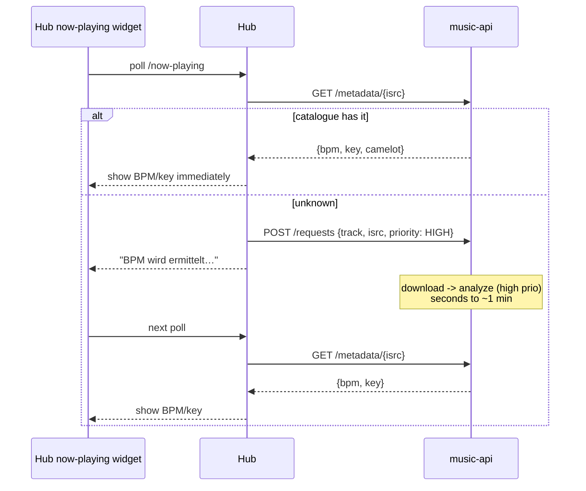

# Plan: hub-crawl-everything

> **Reframed (2026-10-12):** the crawl engine lives in **music-api**, not the hub.
> music-api is the authority; the hub is a thin client that _orders_ and _reads_.
> (Earlier hub-orchestrated drafts of this doc were never committed.)

**Status**: proposed
**Branch**: `feat/music-api-catalogue` (music-api, primary) + `feat/hub-catalogue-client` (hub, thin)
**Ready for review**: no — see **§12 Open decisions**
**Depends on**: `music-api` 0.2/0.3 (durable queue, priority, metadata), `hub-artist-album-0.26.0` (hub views)
**Migration needed**: music-api — new `requests` + `jobs` + catalogue columns; hub — `044_hub_artists_albums.sql` (+ small client state)

---

### Description

Make **music-api the authority** the hub talks to. Users **just order what they
want** at music-api (track / album / artist / url). music-api:

- **records every request forever**, and
- as a **low-priority job**, **keeps growing its library** on its own (e.g.
  "load everything from this artist") **whenever no high-priority task is pending**,
- downloads, **ingests**, and **analyses** (BPM/key), building a permanent
  `track_metadata` catalogue.

The hub then uses that catalogue for **discovery** (filter/sort by BPM/key/genre)
and — the sweet bit — to tell you **the BPM/key of whatever you're hearing**,
usually within seconds.

Everything stays **API-friendly**: one call per unique key per TTL, no hard
duplicates, batched reads, idle-driven background work.

---

### 1. Authority split

| Concern                                                                | Owner         | Notes                                                |
| ---------------------------------------------------------------------- | ------------- | ---------------------------------------------------- |
| Providers (Deezer, deemix, yt-dlp, spotDL), downloads, object store    | **music-api** | The _only_ service that talks to these.              |
| BPM/key/genre catalogue (`track_metadata`), audio analysis             | **music-api** | Persistent, append-only request log; idle expansion. |
| Identity & membership (Spotify/SoundCloud/YouTube ingest, user tokens) | **Hub**       | Hub owns users, playlists, likes, tags, collectives. |
| Social layer (tags, groups, collective curation), discovery **UI**     | **Hub**       | Consumes music-api metadata; never downloads.        |
| Artist/album **entities** (for the UI)                                 | **Hub**       | Derived + fed by both sources; see §6.               |

Rule of thumb: **the hub orders and reads; music-api downloads, analyses,
remembers, and expands.**

---

### 2. The music-api engine

```mermaid
flowchart TD
  REQ[Hub: POST /requests<br/>track | album | artist | url] --> LOG[(requests<br/>append-only, forever)]
  LOG --> JOBS[(jobs: resolve | download | ingest | analyze | expand_*)]
  SCHED{Priority scheduler}
  JOBS --> SCHED
  SCHED -->|high-prio: explicit orders| RUN
  SCHED -->|idle: no high-prio left| EXP[expansion jobs<br/>'load everything from artist']
  EXP --> JOBS
  RUN[download -> ingest -> analyze] --> META[(track_metadata<br/>ISRC -> bpm/key/camelot/genre)]
  RUN --> STORE[(object store: flac/320/128)]
  META --> READ[Hub: GET /tracks + /metadata<br/>batched]
  STORE --> READ
```

**2.1 Permanent request log.** `requests` is append-only and never pruned — every
intent (including a "cheap no-op re-order") is a durable record. It doubles as the
**expansion source**: the set of artists/albums ever touched is the frontier to
grow from. Derived `jobs` are deduped (`UNIQUE(kind, ref)`), so the log can grow
without inflating work.

**2.2 Priority scheduler.** High-prio (explicit user orders) always win. **When the
high-prio queue is empty, low-prio expansion runs** — "load everything from artist
X", album sweeps, re-analysis, backfill. This is the "stetig wachsen im Idle"
behaviour; a global pause already exists (`POST /worker/pause`).

**2.3 Expansion (the graph that makes the library grow).**
`track → artist` · `artist → albums (+appearances) → album tracks` ·
`album → artist`. TTLs + a visited/expanded marker stop loops; per-artist caps stop
runaway. Each downloaded file is ingested → analysed → merged into `track_metadata`.

**2.4 Analysis is default.** A post-download step computes BPM/key and writes
`track_metadata` (`source='essentia'|'analyzer'`). Never re-analysed once present.

**2.5 Reads for consumers.** Batched `GET /tracks?isrcs=`,
`GET /metadata?isrcs=`, single `GET /metadata/{isrc}` (fast path for now-playing),
and — new — a **catalogue/discovery read** (e.g. `GET /catalogue?artist=`,
filters by bpm/key/genre) so the hub can build discovery on top.

---

### 3. Hub side (thin client)

- **Order on touch**: `touch_track` → `POST /requests` (music-api) with a priority
  derived from context (now-playing/manual = high; cascade = normal; expansion =
  music-api's own low-prio).
- **Read-back**: batched `GET /tracks` → `hub_music_state`; `GET /metadata?isrcs=`
  → `hub_track_analysis(source='music-api')`; **create `hub_tracks` from catalogue
  ISRCs we don't have yet** (so the artist's catalogue becomes hub entries).
- **Discovery** uses the catalogue: filter/sort tracks by BPM/key/genre; feed
  ripeness/similarity; surface "we have this / BPM known?".
- The hub keeps a **small** Spotify-side identity crawl (artist albums/top-tracks)
  for membership/ids — but the _audio/metadata_ engine is music-api's.

---

### 4. Now-playing → BPM in seconds (the sweet bit)



Because analysis is a default high-prio job, a freshly seen track gets its BPM/key
fast, and the widget shows it on the next poll.

---

### 5. Current state (verified in `.hub-wt`)

**music-api**

- `POST /orders {items:[{isrc}], priority}` (higher = earlier; **re-order = no-op**),
  `deemix::add_to_queue(url, bitrate)` accepts an **arbitrary URL** (track/album/
  playlist/**artist**) — but is only ever called with a `deezer.com/track/<id>`.
- `tracks` is **ISRC-keyed**; states `pending → downloading → ready|absent|failed`;
  `tracks.state` _is_ the queue. `track_metadata(isrc,bpm,musical_key,camelot,…)`.
- `GET /tracks?isrcs=`, `POST /metadata`, `GET /metadata?isrcs=`, `/worker/pause`.
- **Missing**: permanent request log, derived jobs/scheduler, download-ingest,
  analysis, expansion, discography orders, catalogue/discovery read.

**Hub**

- Ingest via Spotify likes/owned playlists, SoundCloud/YouTube, Traktor,
  on-the-fly now-playing (`nowplaying.rs:105`).
- **Artists/albums are strings**, not entities (grep-verified). Enrichment loops in
  `worker.rs` (`features.rs`, `genres.rs`, `analyze.rs`, `music_api.rs` adapter).

---

### 6. Data model

#### music-api (additive)

```sql
-- Append-only, never pruned.
CREATE TABLE requests (
    id INTEGER PRIMARY KEY,
    kind TEXT NOT NULL,        -- track | album | artist | playlist | url
    ref TEXT NOT NULL,         -- isrc | deezer:album:<id> | deezer:artist:<id> | url
    requested_by TEXT,         -- hub user slug / 'hub' / 'expander'
    priority INTEGER NOT NULL DEFAULT 0,
    note TEXT, created_at INTEGER NOT NULL,
    UNIQUE (kind, ref, requested_by)   -- keep the log rich but bounded per actor
);

CREATE TABLE jobs (
    id INTEGER PRIMARY KEY,
    kind TEXT NOT NULL,        -- resolve | download | ingest | analyze | expand_artist | expand_album
    ref TEXT NOT NULL,
    priority INTEGER NOT NULL DEFAULT 0,  -- high = explicit orders; low/neg = idle expansion
    state TEXT NOT NULL DEFAULT 'queued',
    attempts INTEGER NOT NULL DEFAULT 0, max_attempts INTEGER NOT NULL DEFAULT 5,
    not_before INTEGER, created_at INTEGER NOT NULL, updated_at INTEGER NOT NULL,
    error TEXT, UNIQUE (kind, ref)
);

CREATE TABLE expansion_state (   -- the frontier / "what did we already grow from"
    ref TEXT PRIMARY KEY,        -- deezer:artist:<id>
    expanded_at INTEGER, cursor TEXT, done INTEGER NOT NULL DEFAULT 0
);

-- tracks: allow non-ISRC rows (Deezer-only / yt-dlp) via a surrogate key + nullable isrc.
-- track_metadata: add deezer_id, provider, genre confidence for catalogue reads.
```

#### Hub — `044_hub_artists_albums.sql`

```sql
CREATE TABLE hub_artists (
    id INTEGER PRIMARY KEY, name TEXT NOT NULL, image_url TEXT,
    followers INTEGER, popularity INTEGER, genres TEXT,
    first_seen_at TEXT NOT NULL, updated_at TEXT NOT NULL
);
CREATE UNIQUE INDEX idx_hub_artists_name ON hub_artists(name COLLATE NOCASE);
CREATE TABLE hub_artist_external_ids (
    artist_id INTEGER NOT NULL REFERENCES hub_artists(id) ON DELETE CASCADE,
    service TEXT NOT NULL, external_id TEXT NOT NULL, url TEXT, source TEXT, fetched_at TEXT,
    PRIMARY KEY (artist_id, service, external_id)
);
CREATE TABLE hub_albums (
    id INTEGER PRIMARY KEY, title TEXT NOT NULL, album_type TEXT,
    release_date TEXT, total_tracks INTEGER, image_url TEXT,
    first_seen_at TEXT NOT NULL, updated_at TEXT NOT NULL
);
CREATE INDEX idx_hub_albums_title ON hub_albums(title COLLATE NOCASE);
CREATE TABLE hub_album_external_ids (
    album_id INTEGER NOT NULL REFERENCES hub_albums(id) ON DELETE CASCADE,
    service TEXT NOT NULL, external_id TEXT NOT NULL, url TEXT, source TEXT, fetched_at TEXT,
    PRIMARY KEY (album_id, service, external_id)
);
CREATE TABLE hub_track_artists (
    track_id INTEGER NOT NULL REFERENCES hub_tracks(id) ON DELETE CASCADE,
    artist_id INTEGER NOT NULL REFERENCES hub_artists(id) ON DELETE CASCADE,
    position INTEGER NOT NULL DEFAULT 0, PRIMARY KEY (track_id, artist_id)
);
CREATE INDEX idx_hub_track_artists_artist ON hub_track_artists(artist_id);
ALTER TABLE hub_tracks ADD COLUMN album_id INTEGER REFERENCES hub_albums(id);
CREATE INDEX idx_hub_tracks_album_id ON hub_tracks(album_id);
```

Backfill artist/album rows from the existing distinct strings (name-only).

---

### 7. Source map ("alle Quellen")

| Layer                         | Source                                   | Provides                                                                     |
| ----------------------------- | ---------------------------------------- | ---------------------------------------------------------------------------- |
| Acquire + Analyze + Catalogue | **music-api**                            | FLAC/mp3, discography downloads, BPM/key job, `track_metadata`, object store |
| Identity                      | Spotify (hub)                            | track/artist/album ids, album tracks, top tracks, membership                 |
| Identity                      | Deezer (music-api)                       | ISRC ↔ ids, artist/album enumeration, previews                               |
| Features fallback             | ReccoBeats (free) → FreqBlog (paid)      | BPM/key/energy when there's no file                                          |
| Features fallback             | hub Essentia (`.200:8711`)               | BPM/key + EffNet embedding for non-downloadable                              |
| Genre                         | Last.fm, MusicBrainz                     | crowd tags/genres                                                            |
| Neighbourhood                 | Last.fm `artist.getSimilar`, cosine.club | related artists / audio-similarity (`related-artists` is dead)               |
| Alternate acquire             | yt-dlp / spotDL (music-api)              | tracks without Deezer/ISRC                                                   |

Further candidates (research in `music-hub/docs/music-data-sources.md`): Apple
Music/iTunes Lookup, AcoustID, Discogs, ListenBrainz — I can evaluate these if
wanted.

---

### 8. Interfaces (music-api ↔ hub)

```
POST /requests                       # {kind, ref, priority} — append-only intent
POST /discography-orders             # sugar for {kind:artist|album} requests
GET  /jobs?status=                   # progress of the work queue
GET  /tracks?isrcs=a,b,c             # existing: state + formats + deezerId
GET  /metadata?isrcs=a,b,c           # existing: catalogue read (BPM/key/…)
GET  /metadata/{isrc}                # fast path (now-playing)
GET  /catalogue?artist=&bpm_min=&key= # NEW: discovery read for the hub
```

---

### 9. Settings / knobs

```
# music-api
expand_when_idle           flag   true      # low-prio catalogue growth
expand_max_albums_per_artist num   40
expand_artist_ttl_days     num    90
expand_depth               one_of albums | albums+appearances
analyze_on_ready           flag   true      # BPM/key as a default job
download_priority_hot      num    100
download_priority_expand   num    -10       # below explicit orders

# hub
crawl_order_on_touch       flag   true
crawl_discography_on_touch flag   false      # request ARTIST at deemix (heavy)
crawl_feature_source_chain csv    music-api,reccobeats,freqblog
```

---

### 10. Surface

- Hub now-playing widget: **BPM/key inline** (§4).
- Hub track/artist pages: "order at music-api" / "load discography" + catalogue status.
- `artists.rs`/`albums.rs` read entities instead of string aggregates.
- Optional hub discovery filter by BPM/key/genre once the catalogue read exists.

---

### 11. Phases & acceptance

**P0 — music-api request log + jobs + scheduler** (music-api PR).

- [ ] `requests` append-only; `jobs` deduped via `UNIQUE(kind,ref)`
- [ ] High-prio first; **expansion runs only when no high-prio job is pending**
- [ ] `POST /requests`, `GET /jobs`; global pause respected

**P1 — music-api download-ingest + analyze-as-default** (music-api PR).

- [ ] Downloaded files ingested into `tracks` (ISRC/title/artist/album) incl. non-ISRC rows
- [ ] Post-`ready` BPM/key job → `track_metadata`; not re-analysed if present
- [ ] music-api `cargo test` passes

**P2 — music-api expansion** (music-api PR).

- [ ] `expand_artist` → albums → tracks → ingest → analyze, TTL/caps-bounded
- [ ] Idle-only; never starves explicit orders; `expansion_state` tracks the frontier

**P3 — hub orders + read-back** (hub PR).

- [ ] `touch_track` → `POST /requests` (priority by context); no direct Deezer access
- [ ] Batched `/tracks` + `/metadata` → `hub_music_state`/`hub_track_analysis('music-api')`
- [ ] Catalogue ISRCs not yet in the hub become `hub_tracks` entries

**P4 — hub entities + discovery**.

- [ ] `044` migration; artist/album entities + id capture + backfill
- [ ] Hub discovery can filter/sort by BPM/key from the catalogue
- [ ] Spotify-side identity crawl (artist albums/top-tracks) stays budgeted + TTL'd

**P5 — now-playing BPM UX**.

- [ ] Widget shows BPM/key instantly when the catalogue has the ISRC
- [ ] Otherwise places a high-prio request and shows "wird ermittelt…", then fills in

**P6 — tests + docs**

- [ ] music-api: scheduler/expansion tests (mock deemix); hub: mock music-api cascade
- [ ] `cargo test` green both crates; hub AGENT/roadmap + music-data-sources updated

---

### Files to modify

| File                                                                  | Change                                                                    |
| --------------------------------------------------------------------- | ------------------------------------------------------------------------- |
| `music-api/src/db.rs`                                                 | `requests`, `jobs`, `expansion_state`, non-ISRC tracks, catalogue columns |
| `music-api/src/worker.rs`                                             | scheduler (high-prio vs idle expansion), ingest + analyze steps           |
| `music-api/src/api.rs`                                                | `POST /requests`, `GET /jobs`, `GET /catalogue`                           |
| `music-api/src/deemix.rs`                                             | artist/album URL orders (already URL-capable)                             |
| `music-api/src/{models,config}.rs`                                    | request/job types + knobs (§9)                                            |
| `music-hub/migrations/044_hub_artists_albums.sql`                       | artists/albums/links/ids + backfill                                       |
| `music-hub/src/crawl.rs`                                                | `touch_track` → order + (TTL) identity crawl                              |
| `music-hub/src/music_api.rs`                                            | orders + batched `/tracks`/`/metadata` reads + catalogue import           |
| `music-hub/src/{nowplaying,worker,albums,artists,settings,api,main}.rs` | BPM UX, read-back loop, entities, knobs, routes, CLI                      |

### Risks

- **Runaway expansion** → idle-only, caps, TTLs, `expansion_state`, global pause.
- **Storage/ARL/legal** → discography = GBs; opt-in, budget, Deezer-ARL tier note.
- **Rate limits** → idle work yields to explicit orders; existing backoffs.
- **Cost** → FreqBlog only for gaps.
- **Coupling** → two repos; sequence music-api PRs before the hub client.
- **ISRC-less rows** → surrogate key in `tracks`/`track_metadata`.

### Out of scope (v2)

- Background now-playing poller (unless §12.4).
- Two-way sync back to Spotify/SoundCloud.
- Full embedding/similarity graph (stays `hub-recs-0.25.0`).

---

### 12. Open decisions

1. **Expansion breadth** — how far should idle growth go (albums only /
   +appearances / +related artists via Last.fm/cosine)? Any global cap?
2. **Expansion trigger** — for _every_ ever-requested artist, or opt-in per artist/user?
3. **Analyzer location** in music-api — (a) call Essentia `.200:8711`, (b) embed a
   tool (madmom/aubio/Essentia), (c) hub keeps analysing, music-api only authority?
4. **Now-playing "always on"** — lazy widget poll, or a real per-user background poller?
5. **Catalogue read shape** — is `GET /catalogue` (bpm/key/genre filters) enough for
   hub discovery, or should the hub keep a local mirror of `track_metadata`?
6. **Branches** — `feat/music-api-catalogue` + `feat/hub-catalogue-client`, or fold
   into the `hub-artist-album-0.26.0` milestone?
